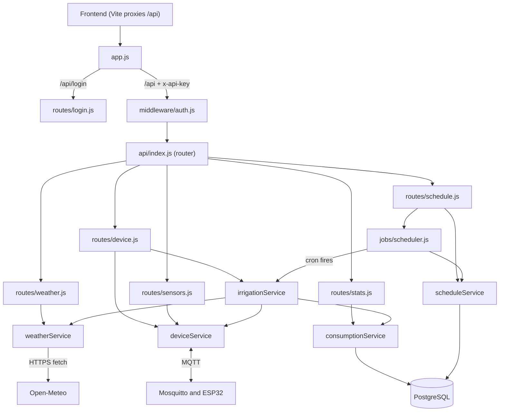
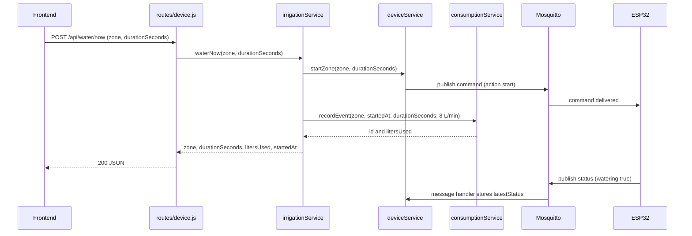
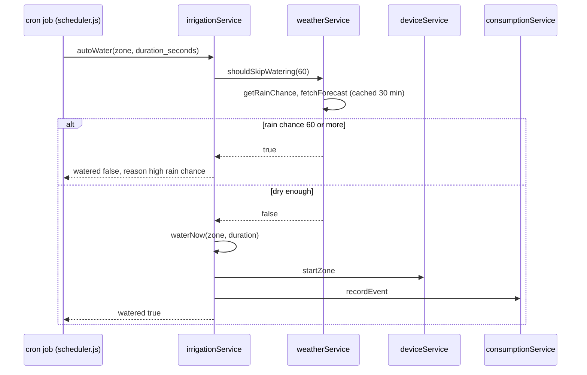

# Klover backend: function map

Scope: the `dpit2026` backend (Express + MQTT + PostgreSQL). Paths are relative to `src/` unless noted.

## 1. Layers at a glance

Rule of thumb: **routes** only read the request and call one service, **services** hold the logic, and only `consumptionService`, `scheduleService` and `db/connection.js` touch Postgres. Only `deviceService` talks MQTT, and only `weatherService` talks to Open-Meteo.

## 2. Startup (`server.js`)

1. `require('dotenv').config()` loads `.env` into `process.env` (must run first).
2. Requiring `src/app.js` builds the Express app (see section 3). Requiring `deviceService` connects to the MQTT broker at once.
3. `db.init()` creates the `watering_events` and `schedules` tables if missing.
4. `app.listen(PORT)` starts the HTTP server.
5. `scheduler.start()` loads enabled schedules and registers one cron job per schedule.

## 3. Request pipeline (`app.js`)

| Order | Middleware | Effect |
|---|---|---|
| 1 | `express.json()` | Parses JSON bodies into `req.body` |
| 2 | `/api/login` → `routes/login.js` | Public, no key needed |
| 3 | `/api` → `auth` → `api/index.js` | Everything else needs a valid `x-api-key` |
| 4 | `errorHandler` | Receives anything passed to `next(error)`, returns 500 |

## 4. Endpoint → function chain

| Endpoint | Route handler (file) | Calls | Ends in |
|---|---|---|---|
| `POST /api/login` | `login.js` | (none) | Returns `{ apiKey }` if password matches `APP_PASSWORD` |
| `POST /api/water/now` | `device.js` | `irrigationService.waterNow` → `deviceService.startZone` + `consumptionService.recordEvent` | MQTT publish + DB insert |
| `POST /api/water/stop` | `device.js` | `irrigationService.stopNow` → `deviceService.stopZone` | MQTT publish |
| `GET /api/water/status` | `device.js` | `deviceService.getStatus` | In-memory read |
| `GET /api/sensors` | `sensors.js` | `deviceService.getSensors` | In-memory read (404 if none yet) |
| `GET /api/weather/rain-chance` | `weather.js` | `weatherService.getRainChance` → `fetchForecast` | Open-Meteo (cached 30 min) |
| `GET /api/weather/current` | `weather.js` | `weatherService.getCurrentConditions` → `fetchForecast` | Open-Meteo (cached 30 min) |
| `GET /api/consumption` | `stats.js` | `consumptionService.getConsumption` → `buildSinceClause` | DB read |
| `GET /api/consumption/by-zone` | `stats.js` | `consumptionService.getConsumptionByZone` → `buildSinceClause` | DB read |
| `GET /api/history` | `stats.js` | `consumptionService.getHistory` | DB read |
| `GET /api/schedule` | `schedule.js` | `scheduleService.getSchedules` | DB read |
| `POST /api/schedule` | `schedule.js` | `scheduleService.createSchedule` → `scheduler.addOrUpdateTask` | DB insert + live cron job |
| `PUT /api/schedule/:id` | `schedule.js` | `scheduleService.updateSchedule` → `scheduler.addOrUpdateTask` | DB update + cron job replaced |
| `DELETE /api/schedule/:id` | `schedule.js` | `scheduleService.deleteSchedule` → `scheduler.removeTask` | DB delete + cron job stopped |

Every route wraps its work in `try/catch` and calls `next(error)` on failure, which lands in `errorHandler`.

## 5. Function reference

### `middleware/auth.js`
| Function | What it does | Called by |
|---|---|---|
| `auth(req, res, next)` | Compares the `x-api-key` header with `API_KEY`. Mismatch → 401, match → `next()`. The key is read once when the file loads. | `app.js`, for every `/api/*` route except login |

### `middleware/errorHandler.js`
| Function | What it does | Called by |
|---|---|---|
| `errorHandler(err, req, res, next)` | Logs the stack, replies `500 { error: 'Something went wrong' }` | Express, after any `next(error)` |

### `services/irrigationService.js` (the decision layer)
| Function | What it does | Called by | Calls |
|---|---|---|---|
| `waterNow(zone, durationSeconds = 300)` | Manual watering. Sends the start command, then logs the event using the fixed `FLOW_RATE_LPM = 8`. Skips the rain check. | `routes/device.js`, `autoWater` | `deviceService.startZone`, `consumptionService.recordEvent` |
| `stopNow(zone)` | Sends the stop command | `routes/device.js` | `deviceService.stopZone` |
| `autoWater(zone, durationSeconds = 300, rainThresholdPercent = 60)` | Scheduled watering. Skips if today's rain chance is at or above the threshold, otherwise runs `waterNow`. | `jobs/scheduler.js` | `weatherService.shouldSkipWatering`, `waterNow` |

### `services/deviceService.js` (MQTT gateway)
| Function | What it does | Called by |
|---|---|---|
| MQTT `connect` handler | Subscribes to `sprinkler/+/status` and `sprinkler/+/sensors` | mqtt client |
| MQTT `message` handler | Parses the JSON. Stores it as `latestStatus[zone]`, or as `latestSensors[zone]` with a `receivedAt` timestamp. | mqtt client, on every incoming message |
| `startZone(zone, durationSeconds)` | Publishes `{action:'start', durationSeconds}` to `sprinkler/<zone>/command` (fire and forget) | `irrigationService.waterNow` |
| `stopZone(zone)` | Publishes `{action:'stop'}` to the same topic | `irrigationService.stopNow` |
| `getStatus(zone)` | Returns the last status, or `{watering:false, remainingSeconds:0}` if none | `routes/device.js` |
| `getSensors(zone)` | Returns the last sensor reading, or `null` | `routes/sensors.js` |

### `services/weatherService.js`
| Function | What it does | Called by |
|---|---|---|
| `fetchForecast()` (private) | Fetches Open-Meteo for `LATITUDE`/`LONGITUDE`. Result cached 30 min. Throws if the response isn't OK. | the three functions below |
| `getRainChance()` | Today's rain probability (%), expected mm and date | `routes/weather.js`, `shouldSkipWatering` |
| `shouldSkipWatering(threshold = 60)` | `true` if rain chance ≥ threshold | `irrigationService.autoWater` |
| `getCurrentConditions()` | Current temperature and whether it is raining now | `routes/weather.js` |

### `services/consumptionService.js`
| Function | What it does | Called by |
|---|---|---|
| `recordEvent({zone, startedAt, durationSeconds, flowRateLpm})` | Computes liters (minutes × flow rate), inserts a `watering_events` row | `irrigationService.waterNow` |
| `getConsumption(period)` | Total liters and event count for today / week / month / all | `routes/stats.js` |
| `getConsumptionByZone(period)` | Same, grouped per zone | `routes/stats.js` |
| `getHistory(limit = 20)` | Newest watering events first | `routes/stats.js` |
| `buildSinceClause(period)` (private) | Returns the SQL `WHERE` fragment for a period | the two consumption functions |

### `services/scheduleService.js` (pure database access)
| Function | What it does | Called by |
|---|---|---|
| `createSchedule({...})` | Inserts a row, returns it (`days_of_week` defaults to `*`, `enabled` to `true`) | `routes/schedule.js` |
| `getSchedules()` | All rows ordered by hour, minute | `routes/schedule.js` |
| `getEnabledSchedules()` | Rows with `enabled = true` | `scheduler.start` |
| `updateSchedule(id, fields)` | Overwrites all fields of one row, returns it | `routes/schedule.js` |
| `deleteSchedule(id)` | Deletes one row | `routes/schedule.js` |

### `jobs/scheduler.js` (turns rows into live cron jobs)
| Function | What it does | Called by |
|---|---|---|
| `buildCronExpression(schedule)` (private) | Builds `"<minute> <hour> * * <days_of_week>"` | `registerTask` |
| `registerTask(schedule)` (private) | Creates the cron job and stores it in the `activeTasks` map. When it fires it runs `irrigationService.autoWater(zone, duration_seconds)`. | `start`, `addOrUpdateTask` |
| `start()` | Loads enabled schedules and registers each one. A bad row is logged and skipped. | `server.js` |
| `addOrUpdateTask(schedule)` | Stops any old job for that id, registers a new one if `enabled` | `routes/schedule.js` |
| `removeTask(id)` | Stops and forgets the job | `routes/schedule.js` |

### `db/connection.js`
| Item | What it does | Used by |
|---|---|---|
| `pool` | Shared Postgres connection pool | `consumptionService`, `scheduleService` |
| `init()` | Creates both tables if they don't exist | `server.js` |

## 6. Main flows step by step

### A. Manual "Start watering"

The HTTP reply does not wait for the ESP32. The page learns the valve opened from the next `GET /api/water/status` poll.

### B. Scheduled run

### C. Reading live state
`GET /api/water/status` and `GET /api/sensors` never call the ESP32. They return whatever the `message` handler last stored, so they reflect the latest MQTT message, not a fresh measurement.

### D. Editing schedules
`POST`/`PUT` write to Postgres first and then call `scheduler.addOrUpdateTask`, so the cron job changes immediately with no restart. `DELETE` removes the row, then calls `scheduler.removeTask`. If the database write fails, the cron job is not touched.

## 7. MQTT contract (backend ↔ ESP32)

| Topic | Direction | Payload |
|---|---|---|
| `sprinkler/<zone>/command` | backend → ESP32 | `{"action":"start","durationSeconds":N}` or `{"action":"stop"}` |
| `sprinkler/<zone>/status` | ESP32 → backend | `{"watering":bool,"paused":bool,"remainingSeconds":N}`: every 5 s while running, every 15 s when idle, and on each state change |
| `sprinkler/<zone>/sensors` | ESP32 → backend | `{"distance_cm","soil_humidity_pct","air_temp_c","air_humidity_pct"}` every 3 s. The backend adds `receivedAt`. |

## 8. Things worth knowing

1. **Water used is logged when a run starts**, for the full requested duration at a fixed 8 L/min. Pauses, early stops, or an ESP32 that is offline do not change it, because the MQTT publish is fire and forget.
2. **Status and sensor data live only in memory** (`latestStatus`, `latestSensors`). After a backend restart they are empty until the ESP32's next message (up to 3 s for sensors, 15 s for status when idle).
3. **`routes/device.js` has no `DEFAULT_ZONE` fallback.** Only `POST /api/schedule` has one. A water request without a `zone` would publish to `sprinkler/undefined/command`. The frontend always sends a zone, so it isn't affected.
4. **Scheduled runs use the backend machine's local clock** (node-cron default). If the weather fetch fails, a scheduled run does not water, because the error is logged by the scheduler. A missing rain probability (`null`) counts as "not rainy".
5. **`.env` is read once at startup**, including the API key (`auth.js`). nodemon doesn't watch `.env`, so after changing it, type `rs` in the backend terminal or restart it.
